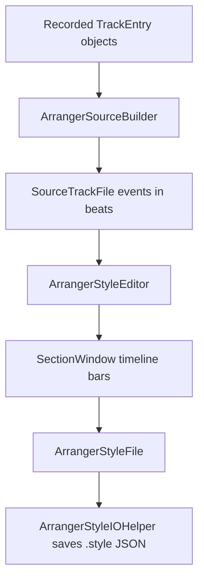
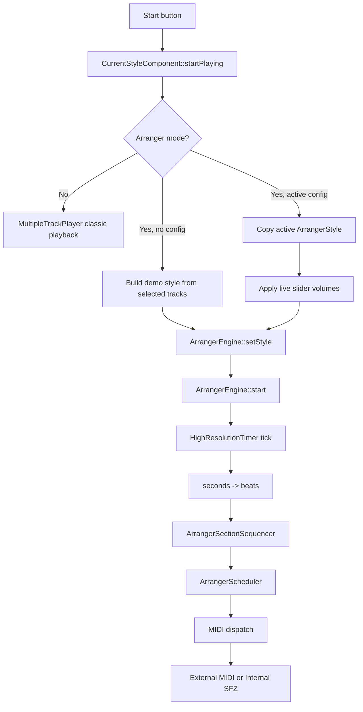

> Part 2 of 2 of [arranger_audio_system](arranger_audio_system.md). Previous: [part 1](arranger_audio_system.md).

## Audio File Guide

### `SFZlibrary.h/.cpp`

Stores and manages the user's SFZ sample library.

Main data:

```cpp
struct SFZLibraryEntry
{
    juce::String id;
    juce::String name;
    juce::String sfzPath;
};
```

Mappings are stored like this:

```text
styleId -> instrumentNumber -> sfzEntryId
```

That means the SFZ mapping is not directly "channel 2 uses this file". It is "for this style, General MIDI instrument 0 uses this SFZ file". Later, when a track says it uses instrument `0` on channel `2`, `MainComponent` asks the manager for the SFZ file for that style/instrument and loads it onto the track's channel.

Important functions:

- `addFile`: adds an SFZ file to the library
- `removeEntry`: removes it and deletes all mappings that used it
- `assignToStyleInstrument`: maps one style/instrument to an SFZ entry
- `importMappingsFromStyle`: copies mappings from one style ID to another
- `getSfzForStyleInstrument`: resolves style/instrument to an actual `juce::File`

The library is loaded/saved through `SFZLibraryIOHelper` in `IOHelper`.

### `SFZLibraryUI.h/.cpp`

UI for managing the SFZ library.

It lets the user:

- add `.sfz` files
- remove files
- assign a selected SFZ to an instrument number for the current style
- import mappings from another style

The instrument picker uses a General MIDI instrument list. The selected instrument number becomes the key for `styleId -> instrumentNumber -> sfzEntryId`.

When mappings change, the UI calls `onLibraryChanged`, and the host saves `SFZLibrary.json` and reloads SFZs for the current style if the internal audio engine is active.

### `AudioHandler.h/.cpp`

The internal SFZ audio renderer.

`AudioHandler` is a JUCE `AudioIODeviceCallback`. That means JUCE calls it repeatedly to fill audio buffers.

It contains:

- 16 `sfzero::Synth` objects, one per MIDI channel
- one `ChannelDSP` per MIDI channel
- a temporary stereo buffer
- loaded-SFZ state per channel
- async loading callbacks
- missing-SFZ notifications

Audio callback flow:

1. Clear the output audio buffer.
2. Ask `MidiHandler` for the next block of queued MIDI.
3. Scan MIDI controllers to update per-channel state.
4. For each MIDI channel with an SFZ loaded:
   - filter that channel's MIDI into a `channelMidi` buffer
   - render that channel's `sfzero::Synth` into `tempBuffer`
   - process per-channel DSP
   - apply channel gain/pan
   - mix into the main output buffer

`loadSfz(file, channel)` loads an SFZ asynchronously. If the file is missing, it clears that channel so an old instrument does not keep playing by mistake.

### `ChannelDSP`

Per-channel post-synth effects.

Controller mapping:

```text
CC7  -> channel gain
CC10 -> pan
CC11 -> expression
CC71 -> filter resonance
CC74 -> brightness / low-pass cutoff
CC80 -> distortion drive
CC91 -> reverb amount
CC92 -> tremolo depth
CC93 -> chorus mix
CC94 -> delay mix/time
CC95 -> random amplitude modulation
```

Some controller notes in the code:

- CC1 vibrato is passed through to `sfzero`; it only works if the SFZ responds to mod wheel.
- CC73/75/72 attack/decay/release are not dynamically applied here because `sfzero` reads those from SFZ regions at load time.

## How Arranger And Audio Work Together

### External MIDI Mode

When the selected output engine is External MIDI:

```text
ArrangerEngine
-> dispatch MIDI
-> juce::MidiOutput::sendMessageNow
-> external synth/device
```

In this mode, `MainComponent` clears the SFZ inject callback and points the display/style playback at the selected MIDI output device.

### Internal SFZ Mode

When the selected output engine is Internal SFZ Synth:

```text
ArrangerEngine
-> onMidiMessage callback
-> MidiHandler::injectMidiMessage
-> MidiHandler internal MidiBuffer
-> AudioHandler audio callback
-> sfzero::Synth per MIDI channel
-> ChannelDSP
-> JUCE audio output device
```

`MainComponent::ensureAudioHandlerReady()` creates `AudioHandler`, installs it as an audio callback, and wires:

```cpp
display->setMidiInjectCallback([this](const juce::MidiMessage& msg) {
    midiHandler.injectMidiMessage(msg);
});
```

`CurrentStyleComponent::setMidiInjectCallback` then assigns that callback to both:

- classic `MultipleTrackPlayer`
- `ArrangerEngine`

So both playback modes can render through the internal SFZ engine.

### Loading SFZs For A Style

`MainComponent::loadSfzForCurrentStyle` loads SFZs for:

- left-hand live instrument on channel `1`
- right-hand live instrument on channel `16`
- every arranger/style track's instrument on that track's assigned channel

For arranger tracks, it asks:

```text
display->getTrackChannelInstruments()
```

That returns channel/instrument pairs, then the SFZ manager resolves each instrument to an SFZ file for the current style ID.

## End-To-End Flow: Creating A Section Configuration



More concretely:

1. The user records or loads tracks.
2. The user opens Section Configurations.
3. `CurrentStyleComponent::openStyleEditorNew` collects current tracks.
4. `ArrangerStyleEditor::loadRecording` converts tracks to source tracks.
5. The editor creates a default Variation window over all bars.
6. The user adds/drags/resizes Intro, Variation, Fill, Break, or Ending windows.
7. The editor rebuilds a preview style whenever windows change.
8. Save writes a `.style` file.
9. The saved style becomes the active arranger configuration.

## End-To-End Flow: Playing Arranger Mode



Important: if arranger mode is enabled but no saved configuration is active, the app builds a demo multi-section style from the currently selected/live tracks. That demo creates Intro, Variation, Fill, and Ending slices from the one captured loop.

## Section Button Behavior

The section buttons call handlers in `CurrentStyleComponent`:

```text
handleIntroCurrentStyle
handleEndingCurrentStyle
handleVarCurrentStyle
handleFillCurrentStyle
handleBreakCurrentStyle
```

In classic mode, these route to `MultipleTrackPlayer`.

In arranger mode:

- if the engine is playing, the section is queued for the next bar boundary
- if the engine is stopped, the section becomes the start section for the next `start()`

This is why pressing `Ending 1` while stopped prepares the engine to start with the ending, but pressing it while playing schedules it for the next bar line.

## Section Transition Rules

### Variation

Variations loop until something else is requested.

```text
Variation 1 -> Variation 1 -> Variation 1 ...
```

### Intro

An Intro usually plays once, then falls through to the return Variation.

```text
Intro 1 -> Variation 1
```

### Fill

A Fill usually plays once, then returns to the Variation that was active when the Fill was requested.

```text
Variation 2 -> Fill 1 -> Variation 2
```

### Break

Break is treated similarly to a one-shot transition section.

```text
Variation -> Break -> Variation
```

### Ending

Ending plays once, then requests engine stop.

```text
Variation -> Ending -> stop
```

### Auto Fill

When Auto Fill is enabled, switching from one Variation to another can insert a matching Fill first.

Example:

```text
currently playing: Variation 1
user presses:      Variation 2
auto fill finds:   Fill 2
result:            Variation 1 -> Fill 2 -> Variation 2
```

The matching is based on section type plus trailing number. `Var 2` can match `Variation 2`, and `Fill 2` can match the same trailing number.

## Why Switches Wait For Bar Boundaries

Musically, section changes should land on a downbeat. The sequencer applies queued requests only at bar boundaries:

```text
4/4, beatsPerBar = 4
bar boundaries = 0, 4, 8, 12, ...
```

If the user presses `Fill 1` at beat `6.2`, the switch does not happen immediately. It waits until beat `8.0`, the next bar line.

This keeps the accompaniment aligned to measures.

## How Looping Avoids Stuck Notes

MIDI notes require both note-on and note-off.

If a note starts near the end of a loop and no note-off appears before the loop wraps, a synth could keep the note sounding forever. `ArrangerScheduler` avoids that by sending note-off messages at loop seams for any still-active notes.

Example:

```text
loop length = 4 beats
note on at beat 3.0
no note off before beat 4.0

at beat 4.0, scheduler sends synthetic note off
then the loop restarts
```

The same idea is used when switching sections: the outgoing section is flushed so its held notes do not bleed into the new section.

## Current Musical Limitations

The current arranger is mostly a loop/section arranger, not yet a full chord-following auto-accompaniment engine.

What it does now:

- captures recorded notes
- converts them to beat positions
- slices them into bar-based sections
- loops or one-shots those sections
- switches sections on bar boundaries
- routes tracks to sensible MIDI channels
- plays through external MIDI or internal SFZ

What is reserved for later:

- chord recognition
- transposing accompaniment to live chords
- special bass-line rules
- key-aware phrase adaptation
- richer part-type behavior beyond channel/metadata

You can see this in fields like `ArrangerTrack::originalChord` and `ArrangerPartType::Bass`, which are present but not yet used for harmonic transformation.

## Integration Files Outside `Source/Arranger` And `Source/Audio`

### `Source/Styles/CurrentStyleComponent.*`

This is the main host for arranger playback inside a style.

It owns:

- `MultipleTrackPlayer` for classic playback
- `ArrangerEngine` for arranger mode
- `ArrangerStyleListComponent`
- optional `ArrangerStyleEditor`
- active arranger configuration state

It decides which engine starts when the user presses Start.

### `Source/UI/MainComponent.*`

This wires the top-level app together.

Important audio/arranger responsibilities:

- loads and saves `SFZLibrary.json`
- creates `AudioHandler` when internal SFZ output is selected
- loads SFZ files for the current style/instruments
- switches between External MIDI and Internal SFZ output engines
- injects playback MIDI into `MidiHandler` for SFZ rendering
- forwards Arranger mode and Auto Fill settings into the display/style component

### `Source/UI/SettingsWindow.*`

This exposes settings UI for:

- output engine selection
- MIDI output device
- audio output device
- SFZ library
- Arranger mode toggle

When the user changes output engine, `MainComponent` opens/closes the correct device and rewires playback.

### `Source/Midi/MidiHandler.*`

This is the MIDI message hub.

For live input, it handles incoming MIDI, hand/channel assignment, transposition, and forwarding to listeners/devices.

For internal SFZ playback, the important functions are:

- `injectMidiMessage`
- `injectCC`
- `getNextMidiBlock`

The arranger injects MIDI into `MidiHandler`; `AudioHandler` consumes that MIDI in the audio callback.

## Test Coverage

The arranger has focused unit tests under `tests/unit`:

- `test_arranger_time.cpp`
- `test_arranger_channels.cpp`
- `test_arranger_defaults.cpp`
- `test_arranger_enums.cpp`
- `test_arranger_midi_hex.cpp`
- `test_arranger_model.cpp`
- `test_arranger_pattern_builder.cpp`
- `test_arranger_scheduler.cpp`
- `test_arranger_section_sequencer.cpp`
- `test_arranger_engine.cpp`
- `test_arranger_source_builder.cpp`
- `test_arranger_style_io.cpp`
- `test_arranger_timeline_geometry.cpp`

`Source/Main.cpp` also supports running the JUCE unit-test category named `Arranger` with the `--arranger-tests` command-line option.

## Mental Model To Keep

Think of the arranger as three layers:

```text
Authoring layer:
recorded tracks + bar windows + .style files

Musical transport layer:
beats, bars, section rules, queued switches, looping

Sound layer:
MIDI messages to external output or injected into SFZ audio rendering
```

The musical-time layer is the center. Once everything is converted to beat positions, the engine does not care whether the sound comes from external MIDI or internal SFZ. It just emits the right MIDI messages at the right beat positions.
