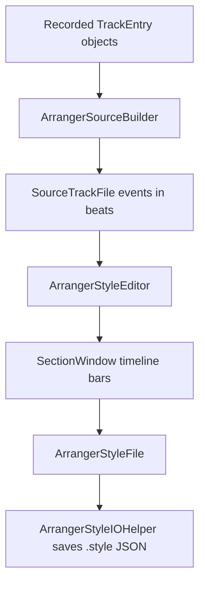
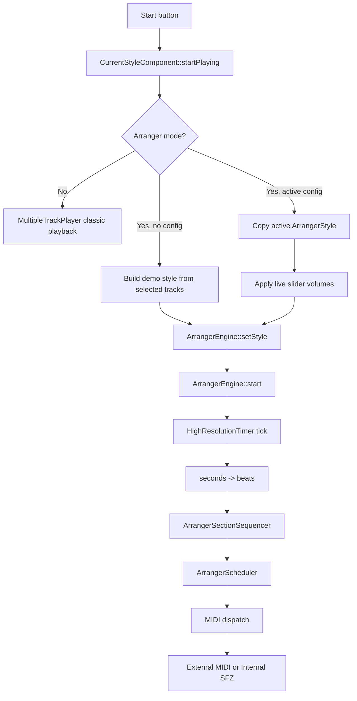

# Arranger And Audio System

This note explains the arranger files in `Source/Arranger`, the audio/SFZ files in `Source/Audio`, and the way they connect to the rest of the app. It also explains the musical-time model: beats, bars/measures, BPM, loop windows, and section switching.

## Short Version

The arranger turns recorded MIDI tracks into reusable musical sections:

1. Recorded track events start as MIDI messages with timestamps in seconds.
2. `ArrangerPatternBuilder` converts note timestamps from seconds to beats.
3. `ArrangerSourceBuilder` turns app tracks into saved source tracks with fixed MIDI channels.
4. `ArrangerStyleEditor` lets the user mark bar windows as sections like Intro, Variation, Fill, Break, and Ending.
5. `ArrangerStyleIOHelper` saves those source tracks and windows into a `.style` JSON file.
6. At playback time, `ArrangerPatternBuilder` slices the saved source tracks into section-local loops.
7. `ArrangerEngine` advances a beat playhead, asks `ArrangerSectionSequencer` which section is active, asks `ArrangerScheduler` which MIDI notes should fire, then dispatches those messages.
8. Messages either go to an external MIDI output, or into the internal SFZ audio path through `MidiHandler` and `AudioHandler`.

The core idea is:

```text
source tracks + bar windows -> runtime sections -> section sequencer -> loop scheduler -> MIDI -> sound
```

## Musical Time Model

### Beat

In this codebase, a "beat" means one quarter note.

That is stated directly in `Source/Arranger/ArrangerTime.h`:

```cpp
/** Pure musical-time conversions. A "beat" is one quarter note. */
```

So the beat unit is not "whatever the time signature denominator says". It is always quarter-note time.

### BPM

BPM means quarter-note beats per minute.

The conversion is:

```text
beats = seconds * (bpm / 60)
seconds = beats * (60 / bpm)
```

Examples:

```text
120 BPM: 1 second = 2 beats
60 BPM:  1 second = 1 beat
90 BPM:  1 second = 1.5 beats
```

This is used when converting recorded MIDI from seconds into arranger beat positions.

### Bar / Measure

Bar and measure mean the same thing here.

The code computes bar length in quarter-note beats:

```text
beatsPerBar = timeSigNum * (4 / timeSigDenom)
```

Examples:

```text
4/4 = 4 * (4 / 4) = 4 quarter-note beats per bar
3/4 = 3 * (4 / 4) = 3 quarter-note beats per bar
6/8 = 6 * (4 / 8) = 3 quarter-note beats per bar
```

Important detail: for `6/8`, the code is counting total quarter-note duration in the bar. It does not model the common "two dotted-quarter pulses" feel separately. It simply says the bar is 3 quarter-note beats long.

### Absolute Beats Vs Local Beats

The arranger uses two beat coordinate systems.

Absolute beats:

```text
0.0, 1.0, 2.0, 3.0, 4.0, ...
```

These are the monotonic playback position since the engine started.

Local section beats:

```text
0.0 ... sectionLengthBeats
```

These are positions inside the currently active section's loop.

For example, in 4/4:

```text
bar 1 starts at beat 0
bar 2 starts at beat 4
bar 3 starts at beat 8
bar 4 starts at beat 12
```

A saved section window uses 1-based bar numbers:

```text
startBar = 3
lengthBars = 2
```

That means:

```text
startBeats = (3 - 1) * 4 = 8
lengthBeats = 2 * 4 = 8
window covers source beats [8, 16)
```

If a source note is at beat `10.5`, the runtime section stores it at:

```text
10.5 - 8 = 2.5 local beats
```

That rebasing is what lets a section loop from local beat `0`.

### Half-Open Time Windows

Schedulers generally treat ranges as:

```text
[fromBeats, toBeats)
```

That means the start is included, the end is excluded. This avoids double-triggering an event exactly on a boundary when one timer tick ends and the next begins.

## Saved Style Vs Runtime Style

There are two related representations.

### Saved `.style` File

Defined by `Source/Arranger/ArrangerStyleFile.h`.

Saved styles contain:

- `SourceTrackFile`: each source MIDI track stored once, with note events in beat time.
- `SectionWindow`: a bar range pointing into the source tracks.
- `ArrangerStyleFile`: metadata plus source tracks plus windows.

This is compact because the notes are not duplicated for each section. The file says: "Here are the recorded tracks; Intro is bars 1-2, Variation is bars 3-6, Fill is bar 6", and so on.

### Runtime `ArrangerStyle`

Defined by `Source/Arranger/ArrangerModel.h`.

Runtime styles contain:

- `ArrangerStyle`: whole style.
- `ArrangerSection`: one playable section with a fixed loop length.
- `ArrangerTrack`: one track inside a section.
- `TimedBeatEvent`: one MIDI event at a beat position inside the section loop.

At runtime, each `SectionWindow` is sliced out of the source tracks and rebased to beat `0`. This creates independent section loops that the engine can schedule quickly.

## Main Data Types

### `TimedBeatEvent`

One MIDI message positioned in beat time:

```cpp
struct TimedBeatEvent
{
    double beats = 0.0;
    juce::MidiMessage message;
};
```

For note duration, there is no separate duration field. A note duration is represented by a note-on event and a later note-off event.

### `ArrangerTrack`

One playable track inside a runtime section.

Important fields:

- `id`: track identity, usually matching the original `TrackEntry`.
- `name`: display name.
- `partType`: drum, percussion, bass, or accompaniment.
- `instrument`: General MIDI program number.
- `channel`: MIDI channel used for playback.
- `volume`: sent as CC7 before playback.
- `pattern`: beat-timestamped note events for this section.

`originalChord` is reserved for later harmonic/transposition phases. In the current arranger, notes are not reharmonized to live chords.

### `ArrangerSection`

One section such as `Variation 1`, `Intro 1`, or `Ending 1`.

Important fields:

- `type`: Intro, Variation, Fill, Break, Ending, CountIn.
- `lengthBars`: how many bars the section loop lasts.
- `afterComplete`: what happens after the section reaches its own end.
- `tracks`: all tracks that play inside this section.

### `ArrangerAfterComplete`

This controls section behavior:

```text
Loop        -> keep looping this section
FallThrough -> play once, then return/fall into a variation
Stop        -> play once, then stop the engine
```

Typical use:

```text
Variation -> Loop
Intro     -> FallThrough
Fill      -> FallThrough
Break     -> FallThrough
Ending    -> Stop
```

## Arranger File Guide

### `ArrangerModel.h`

Defines the runtime arranger schema.

This file is the foundation for the engine. It defines:

- section types
- part types
- completion behavior
- beat-timestamped MIDI events
- tracks
- sections
- full runtime styles

The runtime engine reads `ArrangerStyle`, not the saved `.style` file directly.

### `ArrangerStyleFile.h`

Defines the saved file schema.

This file is for `.style` files on disk. It separates:

- source tracks, which contain the full captured MIDI material
- section windows, which say which bars become Intro/Variation/Fill/etc.

This design avoids storing duplicate MIDI notes when several sections point to different bar ranges of the same recording.

### `ArrangerEnums.h`

Converts enum values to/from strings for JSON and UI.

Examples:

```text
ArrangerSectionType::Variation <-> "Variation"
ArrangerAfterComplete::Stop    <-> "Stop"
ArrangerPartType::Drum         <-> "Drum"
```

When loading unknown strings, it falls back to safe defaults:

```text
unknown section type -> Variation
unknown after rule   -> Loop
unknown part type    -> Acc
```

### `ArrangerMidiHex.h`

Converts raw MIDI messages to hex strings and back.

This is used by `ArrangerStyleIOHelper` so `.style` files can store MIDI messages in JSON:

```json
{ "b": 2.0, "m": "903C64" }
```

Here:

- `b` is the beat position.
- `m` is the raw MIDI bytes as uppercase hex.

### `ArrangerTime.h/.cpp`

Pure musical-time math.

Functions:

- `secondsToBeats(seconds, bpm)`
- `beatsToSeconds(beats, bpm)`
- `beatsPerBar(timeSigNum, timeSigDenom)`
- `barsForBeats(beats, beatsPerBar)`

`barsForBeats` rounds up to whole bars. For example, in 4/4:

```text
8.0 beats    -> 2 bars
8.0001 beats -> 3 bars
0 beats      -> 0 bars
```

This is how the arranger decides the minimum loop length needed to contain all recorded notes.

### `ArrangerChannels.h/.cpp`

Defines arranger MIDI channel allocation.

Rules:

- drums use channel `10`
- melodic accompaniment uses `2, 3, 4, 5, 6, 7, 8, 9, 11, 12, 13`
- channels `1` and `16` are reserved for live left/right hand instruments
- channel `10` is skipped because it is drums
- channels `14` and `15` are avoided because the app uses them for recording/remapping paths

If more than 11 melodic arranger tracks are requested, extra melodic tracks are dropped by the source builder.

### `ArrangerDefaults.h/.cpp`

Creates the default section setup for a new captured recording.

The default is one `Variation 1` spanning all available bars:

```text
Variation 1: start bar 1, length = total bars, afterComplete = Loop
```

The user can then add Intro, Fill, Break, and Ending windows in the editor.

### `ArrangerSourceBuilder.h/.cpp`

Converts live app `TrackEntry` objects into saved `SourceTrackFile` objects.

It does three key things:

1. Assigns stable arranger playback channels.
2. Copies track metadata like name, instrument, and volume.
3. Calls `ArrangerPatternBuilder::buildBeatEvents` to convert note timestamps from seconds to beats.

Percussion tracks become drum source tracks on channel `10`. Melodic tracks become accompaniment tracks on the melodic channel sequence.

### `ArrangerPatternBuilder.h/.cpp`

Builds beat-based arranger content.

Main responsibilities:

- convert `MidiMessageSequence` note events from seconds to beats
- ignore non-note events when building patterns
- force events onto the arranger-assigned MIDI channel
- build a one-section demo style from selected tracks
- build demo Intro/Variation/Fill/Ending sections from a single loop
- slice saved source tracks into section windows
- build the runtime `ArrangerStyle` from a saved `ArrangerStyleFile`

The most important conversion is:

```cpp
ArrangerTime::secondsToBeats(msg.getTimeStamp(), referenceBpm)
```

`referenceBpm` must match the tempo/timebase of the `TrackEntry::sequence` being converted. If the sequence has already been scaled to the current playback tempo, the current playback tempo must be passed in.

#### Slicing Sections

`sliceSection` takes a source section and a beat range:

```text
startBeats = (startBar - 1) * beatsPerBar
endBeats = startBeats + lengthBars * beatsPerBar
```

It keeps events inside `[startBeats, endBeats)` and stores them as:

```text
localBeat = sourceBeat - startBeats
```

That is the heart of turning a recording into reusable arranger sections.

### `ArrangerStyleIOHelper.h/.cpp`

Reads and writes `.style` files as JSON.

On save:

- writes style metadata
- writes source tracks
- writes each event as `{ "b": beat, "m": midiHex }`
- writes section windows with type, start bar, length, and after-complete rule

On load:

- parses JSON
- rebuilds `SourceTrackFile` objects
- decodes MIDI hex back to `juce::MidiMessage`
- rebuilds `SectionWindow` objects

The actual folder comes from `IOHelper::getArrangerStylesFolder()`, which points to the app data folder's `ArrangerStyles` subfolder.

### `ArrangerScheduler.h/.cpp`

Schedules MIDI events for one section loop.

It is deliberately pure and testable:

- no UI
- no audio
- no MIDI output device
- no threading

Given a loop of events and a playhead range, it returns the events that should happen inside that range.

Example:

```text
loop length = 4 beats
event at beat 0.0
event at beat 2.0

advance(0.0, 1.0) -> emits beat 0.0 event
advance(1.0, 3.0) -> emits beat 2.0 event
advance(3.5, 4.5) -> crosses loop seam, then emits next loop's beat 0.0 event
```

It also tracks active notes. If a note-on happens but no note-off appears before the loop seam, it emits a synthetic note-off at the seam. This prevents hanging notes when the loop restarts.

When switching sections, `flushActiveNotes` closes notes that are still sounding in the outgoing section.

### `ArrangerSectionSequencer.h/.cpp`

Decides which section is active over time.

It does not emit MIDI. It only says:

- which section is active
- when a queued section switch should happen
- when a one-shot section has completed
- whether playback should stop

Important behavior:

- starts on the first Variation by default
- section switches happen at the next bar boundary
- pressing multiple section buttons before the boundary keeps only the latest request
- Intro and Fill can play once then fall through
- Ending can play once then request stop
- Auto Fill can insert a Fill before switching from one Variation to another

The sequencer splits a time advance into `SectionSegment`s. For example, if the engine advances from beat `3.8` to `4.2` in 4/4, that crosses a bar boundary at beat `4.0`, so the sequencer may return two segments:

```text
3.8 -> 4.0: old section
4.0 -> 4.2: new section
```

Each segment gives local beat positions for the section scheduler.

### `ArrangerEngine.h/.cpp`

The real-time arranger playback engine.

It owns:

- the current runtime `ArrangerStyle`
- one `ArrangerScheduler` per section
- one `ArrangerSectionSequencer`
- a high-resolution timer
- optional external MIDI output
- optional `onMidiMessage` callback for SFZ injection

Playback flow:

1. `start()` resets schedulers and the sequencer.
2. It sends program changes and CC7 volume for all section tracks.
3. It starts a high-resolution timer.
4. Every timer tick, it measures wall-clock delta time.
5. It converts that delta from seconds to beats using the current BPM.
6. It calls `renderRange(fromBeats, toBeats)`.
7. `renderRange` asks the sequencer for active section segments.
8. Each segment is passed to the correct section scheduler.
9. Scheduler output MIDI is dispatched.
10. If an Ending requests stop, the engine silences all notes and stops itself safely.

Dispatch sends MIDI to both possible destinations:

```cpp
if (auto out = outputDevice.lock())
    out->sendMessageNow(m);

if (onMidiMessage)
    onMidiMessage(m);
```

So the same engine can drive an external MIDI synth, the internal SFZ synth, or both if both are connected.

### `ArrangerTimelineGeometry.h/.cpp`

Pure geometry for the section editor timeline.

It maps:

```text
bar number <-> x pixel
section window <-> rectangle
mouse x <-> snapped bar number
```

The timeline uses 1-based bar numbers. It can snap drags to whole bars and detect whether the user grabbed a region body, left edge, or right edge.

### `ArrangerTimelineComponent.h/.cpp`

The visual timeline editor.

It draws:

- bar grid
- bar numbers
- colored section regions
- selected section outline
- playhead line

It supports:

- selecting a section
- dragging a section to another bar
- resizing a section from the left or right edge
- tooltips like `Intro 1 (bars 1-2)`
- auto-scrolling while dragging near the viewport edge

It knows only about `SectionWindow`s. It does not save files and does not talk directly to audio. It sends callbacks when windows change or a section is selected.

### `ArrangerStyleEditor.h/.cpp`

The full arranger authoring UI.

It connects:

- source tracks
- section windows
- timeline editing
- style saving
- live preview through `ArrangerEngine`

New style flow:

```text
selected TrackEntry objects
-> ArrangerSourceBuilder::fromTrackEntries
-> default Variation window
-> timeline editing
-> buildStyle()
-> engine.setStyle()
```

Save flow:

```text
editor state
-> ArrangerStyleFile
-> ArrangerStyleIOHelper::saveToFile
-> .style JSON file
```

Preview flow:

```text
windows/sourceTracks
-> ArrangerPatternBuilder::buildStyleFromWindows
-> ArrangerEngine::setStyle
-> ArrangerEngine::start
```

The editor also temporarily takes over `engine.onElapsedBeats` so it can show the playhead inside the active section's original timeline window. When the editor closes, `CurrentStyleComponent` restores the normal beat-bar callback.

Long operations like saving, loading, and updating tracks are run on background threads to avoid freezing the UI.

### `ArrangerStyleListComponent.h/.cpp`

The browser for saved `.style` files.

It lists files from the arranger styles folder and exposes callbacks for:

- create new
- edit selected
- delete selected
- load selected
- close browser

It also marks the active configuration with a visual indicator.

## Audio File Guide

### `SFZlibrary.h/.cpp`

Stores and manages the user's SFZ sample library.

Main data:

```cpp
struct SFZLibraryEntry
{
    juce::String id;
    juce::String name;
    juce::String sfzPath;
};
```

Mappings are stored like this:

```text
styleId -> instrumentNumber -> sfzEntryId
```

That means the SFZ mapping is not directly "channel 2 uses this file". It is "for this style, General MIDI instrument 0 uses this SFZ file". Later, when a track says it uses instrument `0` on channel `2`, `MainComponent` asks the manager for the SFZ file for that style/instrument and loads it onto the track's channel.

Important functions:

- `addFile`: adds an SFZ file to the library
- `removeEntry`: removes it and deletes all mappings that used it
- `assignToStyleInstrument`: maps one style/instrument to an SFZ entry
- `importMappingsFromStyle`: copies mappings from one style ID to another
- `getSfzForStyleInstrument`: resolves style/instrument to an actual `juce::File`

The library is loaded/saved through `SFZLibraryIOHelper` in `IOHelper`.

### `SFZLibraryUI.h/.cpp`

UI for managing the SFZ library.

It lets the user:

- add `.sfz` files
- remove files
- assign a selected SFZ to an instrument number for the current style
- import mappings from another style

The instrument picker uses a General MIDI instrument list. The selected instrument number becomes the key for `styleId -> instrumentNumber -> sfzEntryId`.

When mappings change, the UI calls `onLibraryChanged`, and the host saves `SFZLibrary.json` and reloads SFZs for the current style if the internal audio engine is active.

### `AudioHandler.h/.cpp`

The internal SFZ audio renderer.

`AudioHandler` is a JUCE `AudioIODeviceCallback`. That means JUCE calls it repeatedly to fill audio buffers.

It contains:

- 16 `sfzero::Synth` objects, one per MIDI channel
- one `ChannelDSP` per MIDI channel
- a temporary stereo buffer
- loaded-SFZ state per channel
- async loading callbacks
- missing-SFZ notifications

Audio callback flow:

1. Clear the output audio buffer.
2. Ask `MidiHandler` for the next block of queued MIDI.
3. Scan MIDI controllers to update per-channel state.
4. For each MIDI channel with an SFZ loaded:
   - filter that channel's MIDI into a `channelMidi` buffer
   - render that channel's `sfzero::Synth` into `tempBuffer`
   - process per-channel DSP
   - apply channel gain/pan
   - mix into the main output buffer

`loadSfz(file, channel)` loads an SFZ asynchronously. If the file is missing, it clears that channel so an old instrument does not keep playing by mistake.

### `ChannelDSP`

Per-channel post-synth effects.

Controller mapping:

```text
CC7  -> channel gain
CC10 -> pan
CC11 -> expression
CC71 -> filter resonance
CC74 -> brightness / low-pass cutoff
CC80 -> distortion drive
CC91 -> reverb amount
CC92 -> tremolo depth
CC93 -> chorus mix
CC94 -> delay mix/time
CC95 -> random amplitude modulation
```

Some controller notes in the code:

- CC1 vibrato is passed through to `sfzero`; it only works if the SFZ responds to mod wheel.
- CC73/75/72 attack/decay/release are not dynamically applied here because `sfzero` reads those from SFZ regions at load time.

## How Arranger And Audio Work Together

### External MIDI Mode

When the selected output engine is External MIDI:

```text
ArrangerEngine
-> dispatch MIDI
-> juce::MidiOutput::sendMessageNow
-> external synth/device
```

In this mode, `MainComponent` clears the SFZ inject callback and points the display/style playback at the selected MIDI output device.

### Internal SFZ Mode

When the selected output engine is Internal SFZ Synth:

```text
ArrangerEngine
-> onMidiMessage callback
-> MidiHandler::injectMidiMessage
-> MidiHandler internal MidiBuffer
-> AudioHandler audio callback
-> sfzero::Synth per MIDI channel
-> ChannelDSP
-> JUCE audio output device
```

`MainComponent::ensureAudioHandlerReady()` creates `AudioHandler`, installs it as an audio callback, and wires:

```cpp
display->setMidiInjectCallback([this](const juce::MidiMessage& msg) {
    midiHandler.injectMidiMessage(msg);
});
```

`CurrentStyleComponent::setMidiInjectCallback` then assigns that callback to both:

- classic `MultipleTrackPlayer`
- `ArrangerEngine`

So both playback modes can render through the internal SFZ engine.

### Loading SFZs For A Style

`MainComponent::loadSfzForCurrentStyle` loads SFZs for:

- left-hand live instrument on channel `1`
- right-hand live instrument on channel `16`
- every arranger/style track's instrument on that track's assigned channel

For arranger tracks, it asks:

```text
display->getTrackChannelInstruments()
```

That returns channel/instrument pairs, then the SFZ manager resolves each instrument to an SFZ file for the current style ID.

## End-To-End Flow: Creating A Section Configuration



More concretely:

1. The user records or loads tracks.
2. The user opens Section Configurations.
3. `CurrentStyleComponent::openStyleEditorNew` collects current tracks.
4. `ArrangerStyleEditor::loadRecording` converts tracks to source tracks.
5. The editor creates a default Variation window over all bars.
6. The user adds/drags/resizes Intro, Variation, Fill, Break, or Ending windows.
7. The editor rebuilds a preview style whenever windows change.
8. Save writes a `.style` file.
9. The saved style becomes the active arranger configuration.

## End-To-End Flow: Playing Arranger Mode



Important: if arranger mode is enabled but no saved configuration is active, the app builds a demo multi-section style from the currently selected/live tracks. That demo creates Intro, Variation, Fill, and Ending slices from the one captured loop.

## Section Button Behavior

The section buttons call handlers in `CurrentStyleComponent`:

```text
handleIntroCurrentStyle
handleEndingCurrentStyle
handleVarCurrentStyle
handleFillCurrentStyle
handleBreakCurrentStyle
```

In classic mode, these route to `MultipleTrackPlayer`.

In arranger mode:

- if the engine is playing, the section is queued for the next bar boundary
- if the engine is stopped, the section becomes the start section for the next `start()`

This is why pressing `Ending 1` while stopped prepares the engine to start with the ending, but pressing it while playing schedules it for the next bar line.

## Section Transition Rules

### Variation

Variations loop until something else is requested.

```text
Variation 1 -> Variation 1 -> Variation 1 ...
```

### Intro

An Intro usually plays once, then falls through to the return Variation.

```text
Intro 1 -> Variation 1
```

### Fill

A Fill usually plays once, then returns to the Variation that was active when the Fill was requested.

```text
Variation 2 -> Fill 1 -> Variation 2
```

### Break

Break is treated similarly to a one-shot transition section.

```text
Variation -> Break -> Variation
```

### Ending

Ending plays once, then requests engine stop.

```text
Variation -> Ending -> stop
```

### Auto Fill

When Auto Fill is enabled, switching from one Variation to another can insert a matching Fill first.

Example:

```text
currently playing: Variation 1
user presses:      Variation 2
auto fill finds:   Fill 2
result:            Variation 1 -> Fill 2 -> Variation 2
```

The matching is based on section type plus trailing number. `Var 2` can match `Variation 2`, and `Fill 2` can match the same trailing number.

## Why Switches Wait For Bar Boundaries

Musically, section changes should land on a downbeat. The sequencer applies queued requests only at bar boundaries:

```text
4/4, beatsPerBar = 4
bar boundaries = 0, 4, 8, 12, ...
```

If the user presses `Fill 1` at beat `6.2`, the switch does not happen immediately. It waits until beat `8.0`, the next bar line.

This keeps the accompaniment aligned to measures.

## How Looping Avoids Stuck Notes

MIDI notes require both note-on and note-off.

If a note starts near the end of a loop and no note-off appears before the loop wraps, a synth could keep the note sounding forever. `ArrangerScheduler` avoids that by sending note-off messages at loop seams for any still-active notes.

Example:

```text
loop length = 4 beats
note on at beat 3.0
no note off before beat 4.0

at beat 4.0, scheduler sends synthetic note off
then the loop restarts
```

The same idea is used when switching sections: the outgoing section is flushed so its held notes do not bleed into the new section.

## Current Musical Limitations

The current arranger is mostly a loop/section arranger, not yet a full chord-following auto-accompaniment engine.

What it does now:

- captures recorded notes
- converts them to beat positions
- slices them into bar-based sections
- loops or one-shots those sections
- switches sections on bar boundaries
- routes tracks to sensible MIDI channels
- plays through external MIDI or internal SFZ

What is reserved for later:

- chord recognition
- transposing accompaniment to live chords
- special bass-line rules
- key-aware phrase adaptation
- richer part-type behavior beyond channel/metadata

You can see this in fields like `ArrangerTrack::originalChord` and `ArrangerPartType::Bass`, which are present but not yet used for harmonic transformation.

## Integration Files Outside `Source/Arranger` And `Source/Audio`

### `Source/Styles/CurrentStyleComponent.*`

This is the main host for arranger playback inside a style.

It owns:

- `MultipleTrackPlayer` for classic playback
- `ArrangerEngine` for arranger mode
- `ArrangerStyleListComponent`
- optional `ArrangerStyleEditor`
- active arranger configuration state

It decides which engine starts when the user presses Start.

### `Source/UI/MainComponent.*`

This wires the top-level app together.

Important audio/arranger responsibilities:

- loads and saves `SFZLibrary.json`
- creates `AudioHandler` when internal SFZ output is selected
- loads SFZ files for the current style/instruments
- switches between External MIDI and Internal SFZ output engines
- injects playback MIDI into `MidiHandler` for SFZ rendering
- forwards Arranger mode and Auto Fill settings into the display/style component

### `Source/UI/SettingsWindow.*`

This exposes settings UI for:

- output engine selection
- MIDI output device
- audio output device
- SFZ library
- Arranger mode toggle

When the user changes output engine, `MainComponent` opens/closes the correct device and rewires playback.

### `Source/Midi/MidiHandler.*`

This is the MIDI message hub.

For live input, it handles incoming MIDI, hand/channel assignment, transposition, and forwarding to listeners/devices.

For internal SFZ playback, the important functions are:

- `injectMidiMessage`
- `injectCC`
- `getNextMidiBlock`

The arranger injects MIDI into `MidiHandler`; `AudioHandler` consumes that MIDI in the audio callback.

## Test Coverage

The arranger has focused unit tests under `tests/unit`:

- `test_arranger_time.cpp`
- `test_arranger_channels.cpp`
- `test_arranger_defaults.cpp`
- `test_arranger_enums.cpp`
- `test_arranger_midi_hex.cpp`
- `test_arranger_model.cpp`
- `test_arranger_pattern_builder.cpp`
- `test_arranger_scheduler.cpp`
- `test_arranger_section_sequencer.cpp`
- `test_arranger_engine.cpp`
- `test_arranger_source_builder.cpp`
- `test_arranger_style_io.cpp`
- `test_arranger_timeline_geometry.cpp`

`Source/Main.cpp` also supports running the JUCE unit-test category named `Arranger` with the `--arranger-tests` command-line option.

## Mental Model To Keep

Think of the arranger as three layers:

```text
Authoring layer:
recorded tracks + bar windows + .style files

Musical transport layer:
beats, bars, section rules, queued switches, looping

Sound layer:
MIDI messages to external output or injected into SFZ audio rendering
```

The musical-time layer is the center. Once everything is converted to beat positions, the engine does not care whether the sound comes from external MIDI or internal SFZ. It just emits the right MIDI messages at the right beat positions.
